<h3><code>ayush@github ~ $ ./contributions.sh</code></h3>

  

<h3><code>ayush@github ~ $ ./play.sh</code></h3>

  

<h3><code>ayush@github ~ $ whoami</code></h3>

<table>
<tr>
<td valign="top"></td>
<td valign="top"></td>
</tr>
</table>

# Hey, I'm Ayush Shukla

**Researcher • Engineer • Builder**
Research & Prototyping @ Stealth Startup | Security Researcher @ Bugcrowd

I work at the intersection of **Artificial Intelligence, Quantitative Finance, and Emerging Technologies** — researching and prototyping intelligent systems that simplify complexity and improve decision-making.

First-principles thinking. Rapid experimentation. Honest evaluation.

---

## What I build & research

- **AI Agents & Intelligent Systems** — LLM-based agents, RAG workflows, MCP, model context & long-term memory, structured evaluation
- **Quantitative Finance** — multi-agent stock research, backtesting with realistic costs, Pine Script strategies (NSE / BSE / global)
- **Security Research** — OSINT, recon, attack-surface analysis, responsible disclosure (Bugcrowd)
- **Open Source** — exploring, curating and contributing across AI, security and developer tooling

## Flagship project

### finance-ai-agents — launching soon as my first public repo
A multi-agent quantitative stock research system: Analyst, Forecast, Risk and Decision agents analyse a stock independently, state their evidence, disagree openly, and combine into one traceable rating — with backtesting, asset-aware transaction costs, and walk-forward evaluation of the forecast method itself.

*Educational research — not financial advice. Losses and failures are published alongside wins.*

<!-- Link the repo name above once it is published. Pin this repo #1 once launched. Add its forecast-cone chart here. -->

## My research library — Starred Lists

I curate the open-source ecosystem systematically. Start here:

- **AI Agents & Automation** — agent frameworks, orchestration, automation
- **Generative AI & LLMs** — models, RAG, LLM tooling
- **AI & Machine Learning** — ML systems and research code
- **Cybersecurity** — security research and tooling
- **Finance & Trading** — quant, trading systems, market data
- **Lead Generation Tools** — open-source lead-gen stack
- **Research Papers & Learning** — papers, courses, career resources

Full lists: https://github.com/Ayushshuklai?tab=stars

## Tech & skills

**Languages:** Python • Pine Script • HTML
**AI:** LLMs, AI Agents, RAG, MCP, NLP, Machine Learning
**Systems:** Git, GitHub, Linux, CI/CD, Code Review
**Finance:** Quantitative Finance, Algorithmic Trading, Equity Research, Statistical Analysis
**Security:** OSINT, Cyber Threat Hunting, Recon

## Currently

- Research & Prototyping at a Stealth Startup (Feb 2025 — Present)
- Security Researcher at Bugcrowd (Dec 2024 — Present)
- Building in DeFi — prototype & testing phase
- Open to connecting with researchers, founders and engineers working on ambitious ideas

## Connect

- LinkedIn: https://www.linkedin.com/in/ayushshuklai
- GitHub: https://github.com/Ayushshuklai
- Email: ayushshukla.business@gmail.com

---
*Building technology that simplifies complexity.*
